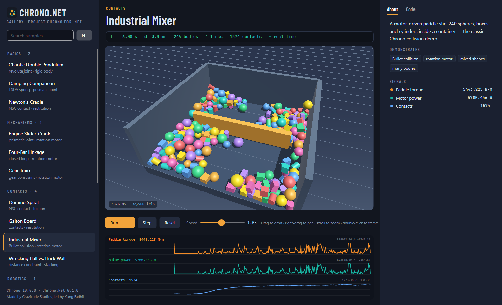
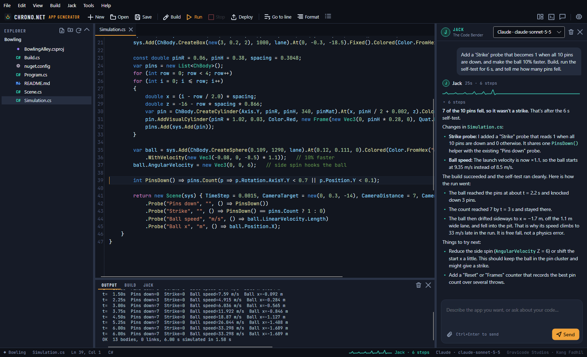
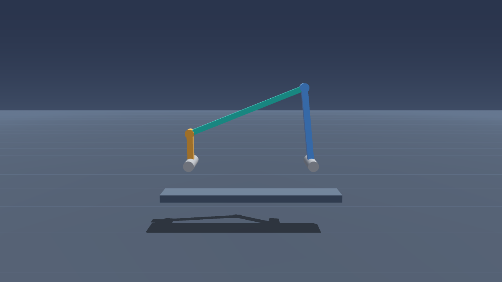
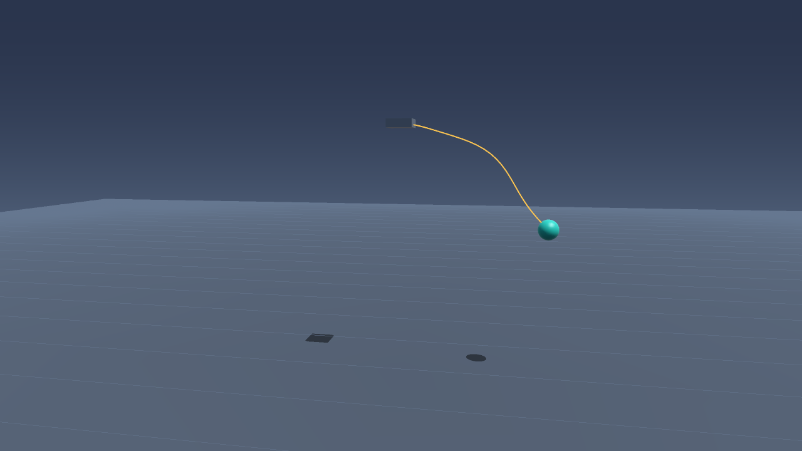
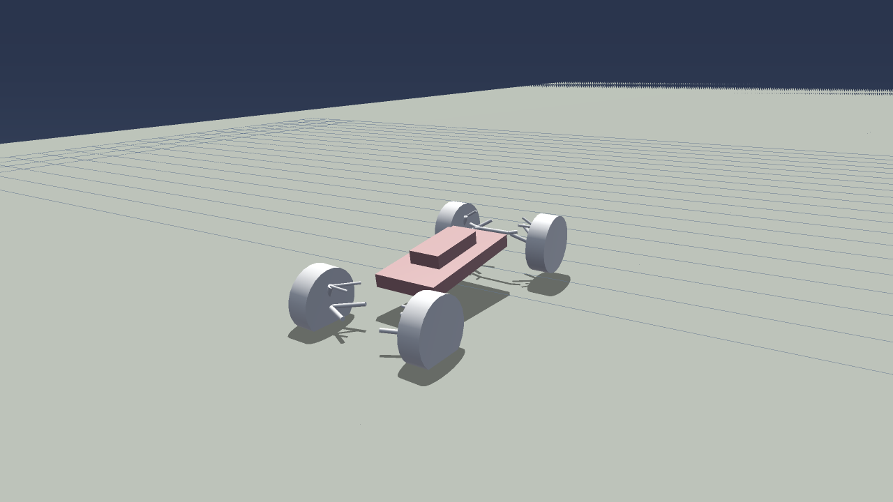

<p align="center"></p>

<h1 align="center">Chrono.Net</h1>

<p align="center">
  <b>Project Chrono multiphysics for .NET 10</b> — rigid bodies, contacts, joints, motors, springs, finite elements and full vehicle models, with Avalonia and Blazor components.<br/>
  <a href="README.id.md">Baca dalam Bahasa Indonesia</a> · <a href="docs/en/getting-started.md">Docs</a> · <a href="docs/id/getting-started.md">Dokumentasi</a>
</p>

<p align="center"></p>

Chrono.Net wraps the C++ engine [Project Chrono](https://projectchrono.org) (v10.0.0) through a thin, allocation-free C ABI. You write C#; Chrono's solvers do the physics.

```csharp
using Chrono.Net;

using var sys = new ChSystem();                                   // NSC contacts, gravity -Y
var mat = sys.Own(new ContactMaterial { Friction = 0.5f });
sys.Add(ChBody.CreateBox(new(10, 1, 10), 1000, mat).At(0, -0.5, 0).Fixed());
var ball = sys.Add(ChBody.CreateSphere(0.25, 7800, mat).At(0, 3, 0));

sys.Step(0.002, 1000);                                            // 1000 steps in one native call
Console.WriteLine(ball.Position);
```

## What's inside

| Package | What it gives you |
|---|---|
| **Chrono.Net** | `ChSystem`, `ChBody` (box, sphere, cylinder, ellipsoid, convex hull, mesh), contact materials (NSC/SMC), 12 joint types, gears, rack-and-pinion, 6 motor types, linear/rotational spring-dampers with C# force laws, contact reports, state snapshots, FEA beams and cables, Chrono::Vehicle (HMMWV, Sedan, Gator, UAZ, CityBus, M113) on rigid or SCM deformable terrain, JSON scenes. Ships native win-x64 binaries. |
| **Chrono.Net.Rendering** | Platform-neutral render model, orbit camera, multithreaded software rasterizer with shadows, PNG and GIF export — works headless. |
| **Chrono.Net.Avalonia** | `ChronoViewport` (interactive 3D), `ChronoPlot` (live signals), `SimulationHost` (real-time loop), and the instrument-bench theme. |
| **Chrono.Net.Blazor** | WebGL viewport (three.js), SVG signal plots, `SimulationLoop` for interactive server rendering. |
| **Chrono.Net.Samples** | 16 ready-to-run scenes used by the Gallery, CLI and docs. |
| **Chrono.Net.Cli** | `chrono` tool: `info`, `list`, `run` (CSV export), `render` (PNG/GIF), `bench`, `new`, `validate`, `source`. |
| **Chrono.Net.Templates** | `dotnet new chrono-console`, `chrono-avalonia`, `chrono-blazor`. |

Plus three apps in this repo: the **Chrono.Net Gallery** (Avalonia desktop and Blazor web), the **Chrono.Net Simulator** for authoring JSON scenes, and **ChronoAppGen**.

### ChronoAppGen — build apps by describing them

A desktop IDE with **Jack — The Code Bender**, an AI assistant (Semantic Kernel; OpenAI, Azure OpenAI, Claude, Gemini, Ollama or DeepSeek) that writes Chrono.Net apps, builds them, runs the physics headless and fixes what breaks. Explorer, tabbed editor with highlighting, build/run/deploy, logs, and 23 verified project templates from simulators and science to industry, safety and games. See [ChronoAppGen](docs/en/appgen.md).

<p align="center"></p>

<table>
<tr>
<td></td>
<td></td>
</tr>
<tr>
<td></td>
<td></td>
</tr>
</table>

## Quick start

```powershell
dotnet new install Chrono.Net.Templates
dotnet new chrono-console -n MySim
cd MySim; dotnet run          # simulates, then writes result.png
```

Or explore the samples:

```powershell
dotnet tool install -g Chrono.Net.Cli
chrono list
chrono render mixer --out mixer.gif --duration 6
chrono run four-bar --duration 5 --csv fourbar.csv
```

## Build from source

Requirements: Windows x64, .NET 10 SDK, Visual Studio 2022+ with the C++ workload (CMake and Ninja ship with it).

```powershell
./build/build-native.ps1            # fetches and builds Project Chrono 10 + Eigen, then the native shim (1–2 h first time)
dotnet build Chrono.Net.slnx
dotnet test --project tests/Chrono.Net.Tests
dotnet run --project samples/Chrono.Net.Gallery.Avalonia
dotnet run --project samples/Chrono.Net.Gallery.Blazor      # then open the printed URL
dotnet run --project tools/Chrono.Net.AppGen                # ChronoAppGen (add an API key in Settings → Models)
```

See [Building from source](docs/en/building-from-source.md) for options, and [Architecture](docs/en/architecture.md) for how the layers fit together.

## Documentation

- [Getting started](docs/en/getting-started.md)
- [Core API guide](docs/en/guide.md) — systems, bodies, shapes, materials, joints, motors, springs, loads, snapshots
- [FEA and vehicles](docs/en/fea-and-vehicles.md)
- [UI components](docs/en/ui-components.md) — rendering, Avalonia, Blazor
- [Tools](docs/en/tools.md) — Gallery, Simulator, CLI, templates, JSON scenes
- [ChronoAppGen](docs/en/appgen.md) — AI app generator IDE with Jack
- [Architecture](docs/en/architecture.md) and [performance notes](docs/en/architecture.md#performance)
- [Building from source](docs/en/building-from-source.md)
- Roadmap: [PLAN.md](PLAN.md) · Progress: [Progress.md](Progress.md)

## License

Chrono.Net is MIT-licensed. It wraps Project Chrono (BSD-3-Clause) and builds with Eigen (MPL-2.0); bundled fonts (Barlow Condensed, JetBrains Mono) are under the SIL Open Font License and three.js is MIT. See [THIRD-PARTY-NOTICES.md](THIRD-PARTY-NOTICES.md).

---

<p align="center"><b>Made by Gravicode Studios, led by Kang Fadhil</b></p>
