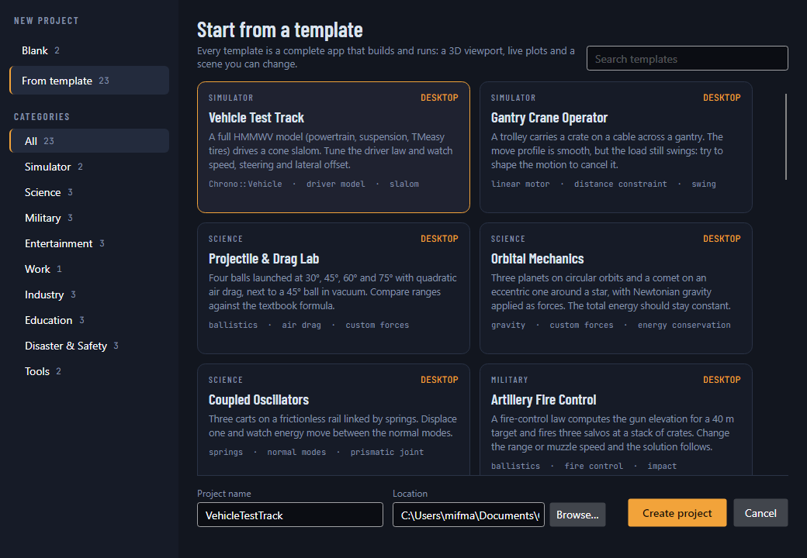
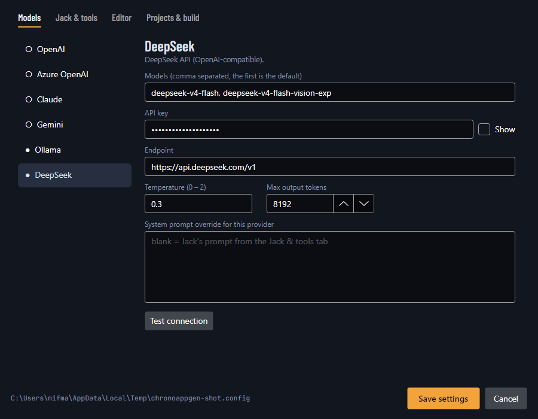

# ChronoAppGen — Chrono.Net App Generator

[Bahasa Indonesia](../id/appgen.md)

ChronoAppGen is a desktop IDE (Avalonia) for building Chrono.Net apps together with **Jack — The Code Bender**, an AI
assistant built on Semantic Kernel. You describe an app; Jack writes the code, builds it, runs the physics headless,
reads the numbers and fixes what is wrong.


```powershell
dotnet run --project tools/Chrono.Net.AppGen            # or: ChronoAppGen.exe [projectFolder]
```

## The window

| Area | What it does |
|---|---|
| Menu and toolbar | **New** project (Ctrl+N), **Open** project (Ctrl+Shift+O) or file (Ctrl+O), **Save** (Ctrl+S), **Close** project, **Build** (Ctrl+Shift+B), **Run** (F5) / **Stop** (Shift+F5), **Deploy** (`dotnet publish`), **Go to line** (Ctrl+G), **Format** (Shift+Alt+F), line numbers on/off (Ctrl+Alt+L), **Exit** |
| Explorer (left) | Project folder tree like VS Code: file-type glyphs, new file/folder, rename, delete, reveal in File Explorer. Updates itself when files change on disk. Toggle with Ctrl+B |
| Editor (center) | Tabs, line numbers, syntax highlighting (C#, AXAML/XML, JSON, Markdown and more), find/replace (Ctrl+F), undo per file, unsaved marker, reload when a file changes on disk |
| Logs (bottom) | **Output** (app output, self-tests), **Build** (compiler output) and **Jack** (every tool call). After a failed build, *Ask Jack to fix the build* sends the errors to Jack. Toggle with Ctrl+J |
| Jack (right) | Model picker at the top, chat thread, image attachments, **Send** with Ctrl+Enter or the button, **Stop**, **Clear thread**. Resize by dragging the splitter; hide with Ctrl+Shift+J |
| Status bar | Project, file, line/column, language, build state, Jack's live work trace, active model, credits |

Each Jack answer starts with a **work trace**: a teal scope line with one pulse per tool call (taller for longer calls,
red dips for failures). Expand *steps* to see every call; hover a step for its arguments and result.

## New projects

**File → New project** offers two starts:

- **Blank** — an empty desktop app (3D viewport, plots, run/step/reset) or an empty console app.
- **From template** — 23 complete apps that build and run, by category:

| Category | Templates |
|---|---|
| Simulator | Vehicle Test Track (HMMWV slalom), Gantry Crane Operator |
| Science | Projectile & Drag Lab, Orbital Mechanics, Coupled Oscillators |
| Military | Artillery Fire Control, Tactical Obstacle Course (HMMWV), Blast Load on a Barrier |
| Entertainment | Pinball Table, Bowling Alley, Marble Run |
| Work | Forklift Pallet Handling |
| Industry | Belt Conveyor Sorter, Inline-4 Engine, Pick & Place Arm |
| Education | Pendulum Lab, Friction on an Inclined Plane, Momentum & Collisions |
| Disaster & Safety | Earthquake Shake Table, Rockfall Protection Barrier, Crash Test Sled |
| Tools | JSON Scene Player, Parameter Sweep (CSV, console) |



Every generated project has the same layout: `Simulation.cs` (the scene and its plotted probes), `Scene.cs`
(container + headless runner), `Build.cs` (helpers), `Program.cs` (window, or console entry) and a README.
`dotnet run -- --selftest [--seconds N]` steps the scene without a window and prints the probes — Jack uses it to check
the physics. All templates are verified by `ChronoAppGen --verify-templates <dir>` (generate, build, self-test).

Projects reference the `Chrono.Net` and `Chrono.Net.Avalonia` packages. Until they are on nuget.org, ChronoAppGen writes
a `nuget.config` that points to a local package folder (auto-detected from a repository build in `artifacts/packages`,
or set in Settings → Projects & build).

## Jack's tools (kernel functions)

| Plugin | Functions |
|---|---|
| workspace | `GetProjectInfo`, `ListFiles`, `ReadFile`, `WriteFile`, `ReplaceInFile`, `SearchFiles`, `CreateFolder`, `DeleteFile`, `RenameFile`, `GetActiveEditor`, `OpenInEditor` — restricted to the project folder |
| build | `BuildProject` (returns compiler errors), `RunSelfTest` (headless physics check), `LaunchApp`, `AddNuGetPackage`, `RunDotnetCommand` (restore, build, clean, list, add, remove, new, format, test) |
| chrono | `GetChronoGuide`, `GetApiReference` (reflected from the Chrono.Net assemblies with XML-doc summaries), `ListSamples`, `GetSampleSource`, `ListProjectTemplates`, `CreateProjectFromTemplate` |
| web | `SearchInternet` (Tavily), `ScrapeWebPage` (readable text of a page) |
| math | `Calculate` (exact expressions), `ConvertUnits` |
| time | `GetCurrentDateTime` (any time zone), `DaysBetween` |

## Models and settings

Supported providers: **OpenAI**, **Azure OpenAI**, **Claude** (Anthropic SDK, optional workspace ID), **Gemini**
(OpenAI-compatible endpoint), **Ollama** (local, no key) and **DeepSeek**. Pick the model at the top of the chat panel.



Everything is stored in **app.config** (`ChronoAppGen.dll.config` next to the executable) and editable in
**Tools → Settings** (Ctrl+,):

- **Models** — per provider: models (comma-separated), API key, endpoint, workspace ID (Claude), temperature (blank =
  provider default; reasoning models that reject a temperature are retried without it), max output tokens, system
  prompt override. *Test connection* sends a one-word request.
- **Jack & tools** — Jack's system prompt (with *Reset to default*), maximum tool calls per message, Tavily key.
- **Editor** — font size and family, indent size, line numbers, word wrap.
- **Projects & build** — projects folder, Chrono.Net and Avalonia versions, local package folder, build configuration,
  deploy runtime, self-contained, single file.

The layout (panel sizes and visibility), the active model and recent projects are saved there too. API keys are never
written to the repository's `App.config` — only to the installed copy.

## Command line

```powershell
ChronoAppGen --list-templates
ChronoAppGen --generate pinball-table C:\work MyPinball
ChronoAppGen --verify-templates C:\temp\verify            # every template: generate, build, self-test
ChronoAppGen --agent "Add a slider for gravity" --project C:\work\MyPinball --provider Claude
```

`--agent` runs one Jack turn on the console with the same tools as the IDE (used for scripted generation and testing).

---
Made by Gravicode Studios, led by Kang Fadhil
