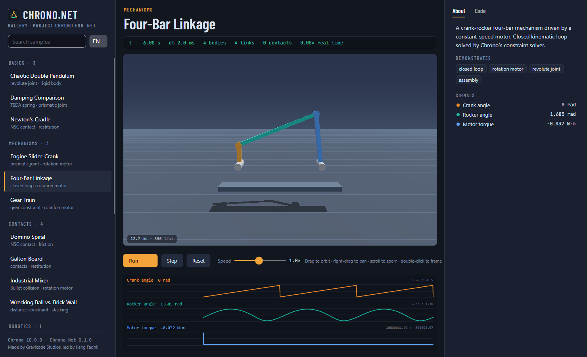

# Perangkat

[English](../en/tools.md)

## ChronoAppGen

IDE pembuat aplikasi berbasis AI (explorer, editor, build/run/deploy, asisten Jack, 23 template proyek) dibahas di halaman tersendiri: [ChronoAppGen](appgen.md).

## Chrono.Net Gallery

Dua aplikasi dengan 16 contoh yang sama dan desain instrument-bench yang sama: indeks contoh, viewport 3D langsung dengan strip pembacaan (waktu, langkah, benda, sambungan, kontak, faktor waktu nyata), plot sinyal bergaya osiloskop, deskripsi dwibahasa (EN/ID) dan kode sumber C# persis dari setiap contoh.

```powershell
dotnet run --project samples/Chrono.Net.Gallery.Avalonia     # desktop
dotnet run --project samples/Chrono.Net.Gallery.Blazor       # web: buka URL yang tercetak, mis. /samples/four-bar
```



| Kategori | Contoh |
|---|---|
| Dasar | Bandul ganda chaos, ayunan Newton, perbandingan redaman |
| Mekanisme | Empat batang, slider-crank mesin, rangkaian roda gigi |
| Kontak | Domino spiral, papan Galton, mixer industri, bola penghancur |
| Robotika | Lengan robot 3-DOF |
| FEA | Kantilever fleksibel, bandul tali berat (ANCF) |
| Kendaraan | Tanjakan HMMWV, pindah jalur sedan, M113 beroda rantai, Gator di tanah deformable |

## Chrono.Net Simulator

Susun dan jalankan scene JSON: buka, sunting dan simpan berkas (seret-lepas juga bisa), "Apply & reload" dari editor JSON, periksa benda apa pun (pose, kecepatan, gaya kontak, energi), plot ketinggian, kecepatan dan energi, ekspor lintasan ke CSV, dan simpan snapshot 1080p.

```powershell
dotnet run --project tools/Chrono.Net.Simulator -- tools/Chrono.Net.Simulator/Scenes/box-pyramid.json
```

## CLI (`chrono`)

```text
chrono info                                   status mesin + pustaka native
chrono list                                   contoh bawaan
chrono run <scene.json|contoh> [--duration s] [--dt s] [--csv berkas]
chrono render <scene.json|contoh> --out berkas.png|berkas.gif [--width 960] [--height 540] [--duration s] [--fps 25]
chrono bench [--bodies 500] [--steps 1000]
chrono new <berkas.json> [--template pendulum|stack|empty]
chrono validate <scene.json>
chrono source <contoh>
```

## Template proyek

| Nama pendek | Membuat |
|---|---|
| `chrono-console` | Simulasi konsol yang menulis `result.png` |
| `chrono-avalonia` | Aplikasi desktop: viewport, plot, jalankan/jeda |
| `chrono-blazor` | Blazor Web App (interactive server) dengan viewport WebGL |

## Berkas scene

```jsonc
{
  "name": "Meja putar",
  "settings": { "contactMethod": "Nsc", "gravity": [0, -9.81, 0], "timeStep": 0.002, "duration": 10,
                "solver": "Psor", "solverIterations": 80, "upAxis": "Y" },
  "materials": { "karet": { "friction": 0.35, "restitution": 0.1 } },
  "bodies": [
    { "name": "ground", "shape": "Box", "size": [12, 1, 12], "position": [0, -0.5, 0], "fixed": true, "color": "#2A3342" },
    { "name": "piringan", "shape": "Cylinder", "axis": "Y", "size": [1.6, 0.15], "position": [0, 0.3, 0], "density": 2000, "material": "karet" },
    { "name": "balok", "shape": "Box", "size": [0.25, 0.2, 0.25], "position": [0.5, 0.48, 0], "array": [5, 1, 1], "arraySpacing": [0.25, 0, 0] }
  ],
  "motors": [ { "type": "RotationSpeed", "body1": "piringan", "body2": "ground", "position": [0, 0.3, 0], "axis": [0, 1, 0],
                "function": { "type": "ramp", "value": 0, "slope": 0.8 } } ]
}
```

- Bentuk: `Box` (panjang sisi), `Sphere` ([r]), `Cylinder` ([r, h] + `axis`), `Ellipsoid` (semi-sumbu), `Capsule` dan `Cone` ([r, h], sepanjang Z lokal).
- `rotation` adalah sudut Euler dalam derajat; `array` mereplikasi benda dalam grid, dan salinannya bernama `nama[i,j,k]`.
- `"ground"` (atau `body2` yang dikosongkan) merujuk ke benda bernama `ground`, atau ke jangkar tetap implisit.
- Fungsi: `const` (`value`), `ramp` (`value`, `slope`), `sine` (`amplitude`, `frequency`, `phase`, `value` = offset), `poly345` (`value` = tinggi, `width`).

---
Dibuat oleh Gravicode Studios dipimpin oleh Kang Fadhil
