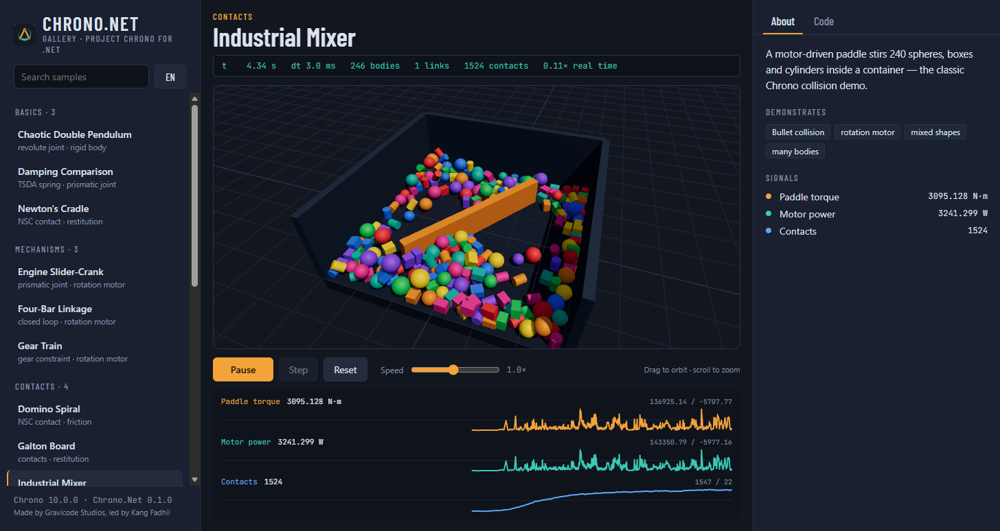

# Komponen UI

[English](../en/ui-components.md)

Ketiga lapisan memakai model render yang sama: `RenderWorld` mengubah `ChSystem` menjadi item render (satu per bentuk visual) dan memperbarui transformasinya setiap frame dengan satu pembacaan keadaan massal.

## Rendering (aplikasi apa pun, termasuk tanpa layar)

```csharp
using Chrono.Net.Rendering;

var world = new RenderWorld(sys, upIsZ: false) { ShowContacts = true };
var cam = new OrbitCamera { Target = new(0, 1, 0), Distance = 8, Yaw = 0.6f, Pitch = 0.4f };

Snapshot.SavePng(world, cam, "frame.png", 1920, 1080);          // supersampling 2×

using var gif = GifEncoder.Create("klip.gif", 640, 360);
var fb = new FrameBuffer(640, 360);
var renderer = new SoftwareRenderer();
for (int f = 0; f < 150; f++)
{
    sys.Step(0.002, 20);
    world.Update();
    renderer.Render(world, cam, fb);
    gif.AddFrame(fb, delayCs: 4);
}
```

`SoftwareRenderer` adalah rasterizer multithread (z-buffer, Blinn-Phong, bayangan planar, grid tanah, garis FEA, titik kontak). `RenderOptions` mengatur warna, grid, bayangan dan cahaya.

## Avalonia

```xml
<Application.Styles>
  <FluentTheme />
  <StyleInclude Source="avares://Chrono.Net.Avalonia/Themes/ChronoTheme.axaml" />
</Application.Styles>
```

```xml
xmlns:cn="clr-namespace:Chrono.Net.Avalonia;assembly=Chrono.Net.Avalonia"
<cn:ChronoViewport x:Name="Viewport" />
<cn:ChronoPlot x:Name="Plot" TimeWindow="8" Height="180" />
```

```csharp
var world = new RenderWorld(sys);
Viewport.World = world;
Viewport.FitToScene();
var energi = Plot.AddSeries("Energi kinetik", "J");

var host = new SimulationHost(sys.Step, timeStep: 0.002);
host.Frame += () =>
{
    world.Update();
    energi.Add(sys.Time, sys.KineticEnergy);
    Viewport.Refresh();
    Plot.Refresh();
};
host.Start();
```

| Kontrol | Sorotan |
|---|---|
| `ChronoViewport` | Putar (seret kiri), geser (seret kanan/tengah), zoom (roda), bingkai ulang (klik ganda); `FollowBody`, `RenderScale`, `ShowStats`, `Options` |
| `ChronoPlot` | Seri ring-buffer, sumbu bertumpuk atau bersama, `TimeWindow` |
| `SimulationHost` | Langkah yang diatur jam dinding dengan anggaran per frame, `Speed`, `RealTimeFactor`, `StepOnce` |

## Blazor (interactive server)

Simulasi berjalan di server dan browser merender dengan WebGL (three.js, sudah disertakan). Setiap frame hanya mengirim transformasi benda sebagai array float biner; jika browser belum mengonfirmasi frame sebelumnya, frame berikutnya dilewati, sehingga klien yang lambat menurunkan laju frame, bukan laju fisika.



```razor
@rendermode InteractiveServer
<link rel="stylesheet" href="_content/Chrono.Net.Blazor/chrono.css" />

<ChronoViewport @ref="_view" World="_world" Camera="@(new ViewportCamera(new Vec3(0,1,0), 8))" />
<ChronoPlot Series="_series" TimeWindow="8" />

@code {
    ChronoViewport? _view;
    RenderWorld _world = default!;
    List<SignalSeries> _series = [new("Ketinggian", "m", "#F2A33A")];
    SimulationLoop _loop = default!;

    protected override void OnInitialized()
    {
        // … bangun sys …
        _world = new RenderWorld(sys);
        _loop = new SimulationLoop(sys.Step, 0.002) { Frame = OnFrame };
        _loop.Start();
    }

    async Task OnFrame()
    {
        _series[0].Add(sys.Time, bola.Position.Y);
        if (_view is not null) await InvokeAsync(_view.PushFrameAsync);
        await InvokeAsync(StateHasChanged);
    }
}
```

`ViewportCamera.FollowBody` menjaga sebuah benda (misalnya sasis kendaraan) tetap di tengah.

---
Dibuat oleh Gravicode Studios dipimpin oleh Kang Fadhil
